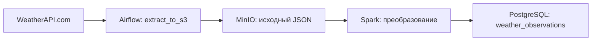
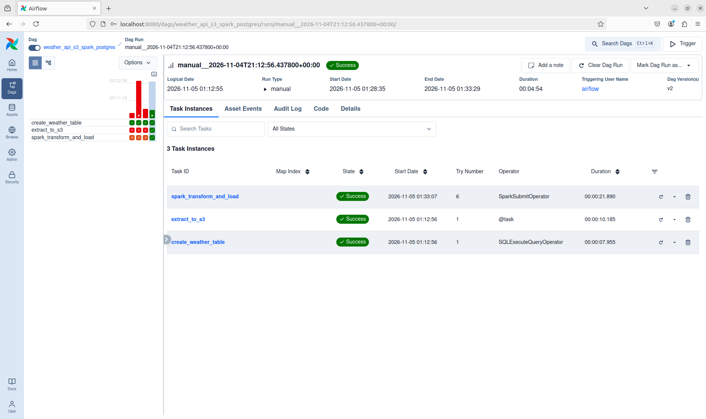

# Погодный ETL на Airflow и Spark

Пайплайн ежечасно получает текущую погоду Москвы, сохраняет исходный ответ API в S3 хранилище и загружает наблюдение в PostgreSQL. Airflow управляет расписанием и зависимостями, а PySpark преобразует вложенный JSON в строку таблицы.

## Пайплайн



| Задача DAG | Что выполняет |
|---|---|
| `extract_to_s3` | Запрашивает текущую погоду и сохраняет JSON в бакет `weather-data`. Передаёт путь к объекту через XCom. |
| `create_weather_table` | Создаёт таблицу наблюдений, если её ещё нет. |
| `spark_transform_and_load` | Spark читает JSON из MinIO, преобразует время в UTC и записывает температуру, влажность, скорость ветра и координаты. |

В таблице сохраняются `source_file` с адресом исходного объекта и `loaded_at` со временем загрузки. По ним можно проследить путь наблюдения.

## Окружение

| Сервис | Конфигурация | Адрес на хосте |
|---|---|---|
| Airflow | 3.1.8, LocalExecutor, API server, scheduler и DAG processor | http://localhost:8080 |
| Spark | Spark и PySpark 4.0.5, Standalone master и worker | http://localhost:8081 |
| MinIO | Локальный образ `minio/minio:latest` | http://localhost:9001 |
| PostgreSQL | 18, базы `airflow` и `weather` | `localhost:5432` |

## Запуск на Ubuntu

Понадобятся Docker с Compose и ключ [WeatherAPI.com](https://www.weatherapi.com/). Создаём файл настроек:
```bash
[ -f .env ] || cp .env.example .env
```

Указываем ключ WeatherAPI в локальном `.env` как `WEATHERAPI_KEY=` и запускаем контейнеры:
```bash
docker compose config --quiet
docker compose up -d --build --remove-orphans
docker compose ps -a
```

Сервисы `airflow-init` и `minio-init` должны завершиться с кодом 0. Первый подготавливает базу метаданных и пользователя Airflow, второй создаёт бакет. PostgreSQL 18 использует том `postgres18-data`. Если на хосте остался том прежней версии, для его данных потребуется отдельная миграция.

## Как проверить результат

1. Открываем Airflow на порту 8080.
2. Входим с логином `airflow` и паролем `airflow`. Запускаем DAG `weather_api_s3_spark_postgres`.
3. Проверяем, что три задачи завершились со статусом `success`. В MinIO Console открываем бакет `weather-data` и ищем JSON под префиксом `raw/weatherapi/`. Логин minio и пароль minio.
4. Проверяем последние записи в PostgreSQL. Значение `source_file` указывает на исходный JSON.

```bash
docker compose exec -T postgres psql -U airflow -d weather -c \
  'SELECT observed_at, temperature_c, relative_humidity_pct, wind_speed_kmh, source_file, loaded_at
   FROM weather_observations ORDER BY loaded_at DESC LIMIT 5;'
```
Останавливаем стенд с сохранением данных:
```bash
docker compose down
```

## Код проекта

- Расписание, зависимости и извлечение данных. [DAG](dags/weather_pipeline.py)
- Преобразование JSON и загрузка через JDBC. [Spark job](spark/jobs/weather_job.py)
- Сервисы, тома и подключения. [Docker Compose](docker-compose.yml)

